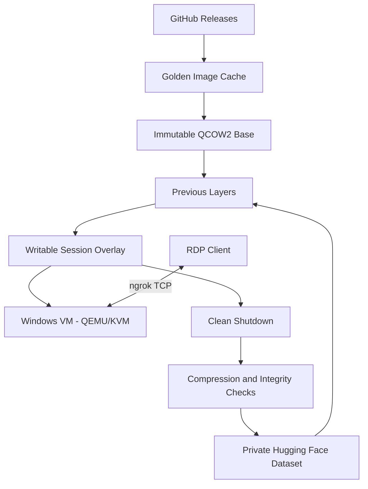

# AuroFlow Engine


[](https://github.com/fox3000foxy/auroflow-engine/actions/workflows/windows-persistent.yml)

A lightweight, debloated and performance-oriented Windows 10 IoT Enterprise LTSC 2021 golden image for QEMU/KVM, featuring automated deployment, RDP connectivity and persistent storage across ephemeral runners.

No Windows reinstallation. No full disk upload after each session. Only incremental changes are saved.

## Features

- Lightweight 4.82 GiB compressed Windows image.
- Hardware-accelerated virtualization through KVM.
- Automatic CPU and RAM allocation.
- Preinstalled VirtIO drivers.
- RDP optimized for up to 60 FPS.
- Automated ngrok TCP integration with encrypted session endpoint metadata.
- Optional Hugging Face persistence.
- Incremental Zstandard-compressed QCOW2 layers and compatible custom Golden Images.
- Preserved UEFI and TPM state.
- Parallel release asset downloads.
- APT, pip, ngrok and Golden Image caching.
- Automatic shutdown and integrity-checked backups.
- Offline compaction of accumulated layers with remote restore verification.
- Hugging Face history squash and orphan LFS cleanup, with destructive-operation safeguards.
- Standalone deployment with no external orchestration repository required.

## Quick start

### 1. Fork the repository

Fork this repository and enable GitHub Actions.

### 2. Configure repository secrets

Navigate to **Settings → Secrets and variables → Actions**.

| Secret | Required | Description |
|---|---|---|
| `NGROK_AUTHTOKEN` | Yes | ngrok authentication token |
| `HF_TOKEN` | For persistence | Hugging Face token with dataset creation and write permissions |

Tokens can be obtained from:

- [ngrok Dashboard](https://dashboard.ngrok.com/get-started/your-authtoken)
- [Hugging Face Settings](https://huggingface.co/settings/tokens)

The current encrypted-session workflow also requires the Actions variable `AUROFLOW_PUBLIC_KEY`, populated automatically when starting an instance from the [AuroFlow Dashboard](https://fox3000foxy.com/auroflow/dashboard/). It must contain a base64-encoded 32-byte Curve25519 public key. Direct workflow dispatch without this variable fails at tunnel publication rather than exposing a plaintext RDP endpoint.

Use `GOLDEN_URL` and `GOLDEN_SHA256` to select a compatible custom QCOW2 Golden Image, or leave `GOLDEN_URL` empty to use the reference image. A custom image must meet the VM's x86-64, UEFI, VirtIO and RDP requirements. The base image is immutable; accumulated layers are tied to its checksum.

An optional repository variable, `HF_REPO`, allows you to specify a custom Hugging Face dataset.

Otherwise, the dataset is automatically created using the following naming convention:

`<huggingface-username>/<github-repository>-layers`

### 3. Launch the workflow

Before exposing the VM, configure a strong Windows password through a trusted connection and restrict network access to the ngrok endpoint. The reference image contains a passwordless account, and the ngrok agent token does not authenticate RDP clients.

For normal use, configure your workspace and launch the VM from the [AuroFlow Dashboard](https://fox3000foxy.com/auroflow/dashboard/). It registers the per-workspace encryption public key before triggering the GitHub Actions workflow.

For manual workflows, first configure `AUROFLOW_PUBLIC_KEY` and the required secrets in the repository. The GitHub Actions workflow is named **AuroFlow VM**.

Alternatively, use GitHub CLI:

```bash
gh workflow run windows-persistent.yml --ref main
```

### 4. Connect to Windows

After the **Start ngrok RDP tunnel** step completes, the Engine encrypts the ngrok TCP address with the workspace public key and publishes `encrypted_endpoint` in schema-v3 `session.json` on `golden-control`. It does not write the plaintext address to that session file or print it for the user.

Open the Dashboard in the browser that started the session to decrypt and copy the RDP `host:port` address or download a `.rdp` connection file. The reference Windows username is `Cloud` and its password is empty by default. Configure a strong password before remote use.

### 5. Save your session

Shut down Windows normally using the Start menu or:

```powershell
shutdown /s /t 0
```

Wait for the workflow to complete.

**Do not cancel the workflow if you want to preserve your changes.**

## Operating modes

| Feature | Fresh mode | Persistent mode |
|---|---|---|
| Hugging Face token | Not required | Required |
| Golden Image | Yes | Yes |
| Writable overlay | Yes | Yes |
| RDP access | Yes | Yes |
| Automatic backup | No | Yes |
| Session restoration | No | Yes |
| Persistent files and applications | No | Yes |

Persistent mode is enabled when `HF_TOKEN` is configured. If the token is omitted, changes cannot be persisted across runs. RDP tunnel publication still requires `AUROFLOW_PUBLIC_KEY` in either mode.

## Architecture



The Golden Image remains unchanged throughout the virtual machine lifecycle.

Each session creates a writable QCOW2 overlay backed by the Golden Image and any previously saved layers.

When Windows shuts down:

1. QMP detects the guest shutdown.
2. QEMU and the emulated TPM are stopped.
3. The session overlay is compressed using Zstandard.
4. Disk integrity and content equivalence are verified.
5. SHA-256 checksums and a manifest are generated.
6. The new layer, UEFI state and TPM state are published to Hugging Face.

The next session restores the complete layer chain before booting Windows.

## System specifications

| Property | Value |
|---|---|
| Operating system | Windows 10 IoT Enterprise LTSC 2021 |
| Windows version | 21H2 |
| Base build | 19044.1288 |
| Architecture | x86-64 |
| Language | English (United States) |
| Virtual disk capacity | 64 GiB |
| Image file size | 4.82 GiB |
| Allocated disk size on reference host | 4.74 GiB |
| Image format | QCOW2 |
| Compression | Zstandard |
| Cluster size | 64 KiB |
| Firmware | UEFI / OVMF |
| TPM | Emulated TPM 2.0 |
| Hypervisor | QEMU/KVM |
| Machine type | pc-q35-10.0 |
| Remote access | RDP |
| Activation method | Massgrave (MAS) |

## Windows optimizations

The reference installation has been optimized using [Windows10Debloater](https://github.com/Sycnex/Windows10Debloater) and additional system configuration.

### System performance

- Reduced visual effects.
- High-performance power configuration.
- Restricted background applications.
- Disabled transparency effects.
- Disabled Game DVR and background recording.
- Reduced indexing and unnecessary background services.
- Disabled hibernation and automatic sleep.
- Disabled consumer content and suggestions.
- Windows component store cleanup.
- CompactOS compression.

### Virtualization

- KVM hardware acceleration.
- Host CPU passthrough.
- Hyper-V enlightenments.
- VirtIO SCSI storage.
- VirtIO networking.
- VirtIO memory balloon device.
- Q35 PCI Express topology.
- UEFI firmware.
- Emulated TPM 2.0.
- QMP management interface.

### Remote Desktop

- Target frame rate of up to 60 FPS.
- DWM frame interval configured to 15 ms.
- AVC444 encoding preferred.
- Automatic RDP service startup.
- Clipboard redirection.

Actual performance depends on the host, network connection and RDP client.

## Dynamic resource allocation

The VM automatically allocates available host resources.

- CPU: available logical processors.
- RAM: available memory minus approximately 1 GiB, rounded down to 256 MiB.

Resources can also be overridden using environment variables.

| Variable | Description |
|---|---|
| `VM_CPU` | Number of virtual CPUs |
| `VM_RAM` | Allocated memory in MiB |
| `VM_ROOT` | Virtual machine working directory |
| `OVMF_FIRMWARE` | OVMF firmware path |

The reference GitHub Actions test successfully allocated 4 vCPUs and 13 GiB of RAM.

## Encrypted session publishing

The Dashboard creates a workspace-specific Curve25519 key pair locally and writes only the public key to the `AUROFLOW_PUBLIC_KEY` Actions variable. The Engine uses PyNaCl SealedBox to encrypt a payload containing the repository, workflow run ID and RDP endpoint. The session control branch stores `schema_version: 3` and `encrypted_endpoint`; plaintext fallback is rejected. The browser retains the private key, and losing it prevents decrypting an active session.

The encryption protects the endpoint in published session metadata, not the RDP protocol or Windows account. A discovered tunnel can still be accessed; set strong Windows credentials and secure the workspace.

## Disk optimization

| Stage | Allocated size |
|---|---:|
| Initial optimized installation | 9.0 GiB |
| After ReTrim | 6.4 GiB |
| After Zstandard compression | 4.74 GiB |

**Approximately 47% storage reduction**, while retaining the full 64 GiB virtual disk capacity.

A newly created writable overlay initially occupies approximately 196 KiB.

## Automatic layer compaction and LFS cleanup

The `compact-layers.yml` workflow runs daily at `0 4 * * *` (04:00 UTC) and can be dispatched manually. Manual `dry_run` defaults to `true`. The VM workflow and the compact workflow share the `windows-golden` GitHub Actions concurrency group, so they cannot operate on persistence layers concurrently.

When there are at least two saved layers, the compactor downloads and verifies the Golden Image and the entire layer chain, copies the overlays into temporary storage and commits them into a single differential QCOW2 layer without modifying the immutable base. It compares the consolidated disk with the original guest-visible disk and skips publication if the new layer is larger. A successful commit replaces the chain in `latest.json` and deletes the obsolete layer paths at the dataset HEAD. A fresh remote restore verifies disk, UEFI, TPM and content equivalence.

With history cleanup enabled, the workflow runs `super_squash_history` only after successful remote verification. It then audits live LFS object hashes and references before permanently deleting unreferenced objects. This destruction is irreversible. Retain an independent backup of important data; history rewriting removes old recovery points.

| Variable | Purpose | Instance default |
|---|---|---|
| `AUROFLOW_COMPACTION_ENABLED` | Run the scheduled compact workflow | Off unless set to `true` |
| `AUROFLOW_SQUASH_HISTORY` | Squash Git history and clean orphan LFS after a verified compaction | Off unless set to `true` |

The template and the existing test instance do not currently share the same defaults. A scheduled workflow is not a guarantee of runtime success; inspect its logs, especially after enabling destructive cleanup.

In a verified test, three layers totalling 1090.3 MiB were consolidated to 998.1 MiB (8.5% reduction); a remote restore and Windows boot succeeded. Orphan LFS cleanup was also verified manually on the test dataset (approximately 1.144 GB recovered). The full scheduled cleanup path still requires observation in operation.

## Caching and performance

The workflow caches:

- APT dependencies.
- Python packages.
- ngrok executable.
- Golden Image and reference VM state.

The Golden Image cache is saved before the virtual machine starts, allowing subsequent executions to reuse it even if a later session fails.

### Observed benchmarks

| Operation | Duration |
|---|---:|
| Golden Image preparation without cache | 52.79 s |
| GitHub cache restoration | ~39 s |
| Golden Image preparation after cache restoration | 3.46 s |
| First persistent layer backup | ~17 s |

The total cached preparation time includes cache restoration. Actual results depend on runner performance, network throughput and session size.

Reference executions:

- [Cold cache execution](https://github.com/fox3000foxy/auroflow-engine/actions/runs/45795416829)
- [Successful persistence execution](https://github.com/fox3000foxy/auroflow-engine/actions/runs/45796701342)

## Session lifecycle

The workflow has a maximum duration of 300 minutes.

An automatic ACPI shutdown is requested after 287 minutes from initialization, reserving time for the final backup.

Manual Windows shutdown triggers the same persistence process immediately.

If Windows or the hypervisor cannot shut down cleanly, the backup is skipped to avoid publishing potentially inconsistent disk state.

## Local installation

### Requirements

- Linux x86-64.
- Hardware virtualization and accessible `/dev/kvm`.
- QEMU supporting `pc-q35-10.0`.
- Compatible OVMF firmware.
- swtpm.
- GitHub CLI.
- Sufficient disk space.

### Installation

```bash
sudo apt install qemu-system-x86 qemu-utils qemu-block-extra ovmf swtpm swtpm-tools gh

git clone https://github.com/fox3000foxy/auroflow-engine.git
cd windows10-golden

gh release download golden-v1.0

cat windows10-golden.qcow2.part-* > windows10-golden.qcow2

sha256sum -c windows10-golden.qcow2.sha256
qemu-img check windows10-golden.qcow2

tar -xzf vm-state.tar.gz

chmod 444 windows10-golden.qcow2

qemu-img create -f qcow2 -F qcow2 \
    -b windows10-golden.qcow2 disk.qcow2

bash boot-vm.sh
```

Connect using RDP:

```text
127.0.0.1:3390
```

For remote Linux hosts, SSH forwarding can be used:

```bash
ssh -N -L 3390:127.0.0.1:3390 user@host
```

The local boot script runs QEMU in headless mode. After shutting down the guest, use QMP to terminate QEMU, as the `-no-shutdown` option keeps the hypervisor running.

## Validation

| Test | Status |
|---|---|
| Local QEMU/KVM boot | Passed |
| VirtIO storage and networking | Passed |
| Golden Image integrity | Passed |
| Overlay write isolation | Passed |
| GitHub Actions deployment | Passed |
| Dynamic resource allocation | Passed |
| Golden Image cache | Passed |
| RDP through ngrok | Passed |
| Clean QEMU and TPM shutdown | Passed |
| Hugging Face layer publication | Passed |
| Layer restoration | Passed |
| Cross-runner file persistence | Passed |

Cross-runner persistence was successfully demonstrated by creating a desktop folder, shutting down Windows, launching a new workflow and verifying that the folder remained present.

## Roadmap

- Monitoring of scheduled compaction and history/LFS cleanup under real workloads.
- Parallel Hugging Face layer downloads.
- Session snapshots.
- Rollback to previous sessions.
- Extended testing of long layer chains.
- Extended testing of automatic deadline shutdown.

## Security and licensing

The reference Windows installation uses the `Cloud` account with no default password. Configure strong credentials and restrict network access before exposing RDP.

Persistence datasets are private by design. Never commit authentication tokens or store private session layers in public caches. Dataset history squash and LFS deletion are permanent and can make historical rollbacks impossible.

The reference UEFI and TPM state is shared and should not be treated as a unique private device identity.

The reference installation was activated using [Massgrave (MAS)](https://massgrave.dev/). Activation does not constitute a Windows license. Users are responsible for obtaining appropriate Microsoft licensing and redistribution rights.

Use GitHub-hosted runners in accordance with GitHub's applicable terms. General-purpose remote desktop deployments should use an appropriate dedicated or self-hosted KVM environment.

## Credits

- [Microsoft Windows](https://www.microsoft.com/windows)
- [QEMU](https://www.qemu.org/)
- [KVM](https://www.linux-kvm.org/)
- [VirtIO Windows Drivers](https://github.com/virtio-win/kvm-guest-drivers-windows)
- [Windows10Debloater](https://github.com/Sycnex/Windows10Debloater)
- [Massgrave](https://massgrave.dev/)
- [Zstandard](https://github.com/facebook/zstd)
- [Hugging Face](https://huggingface.co/)
- [ngrok](https://ngrok.com/)
- [vm-sync](https://github.com/fox3000foxy/vm-sync) — original inspiration.

---

Built for lightweight, reproducible and persistent Windows virtualization.
